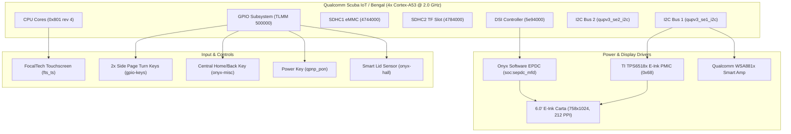
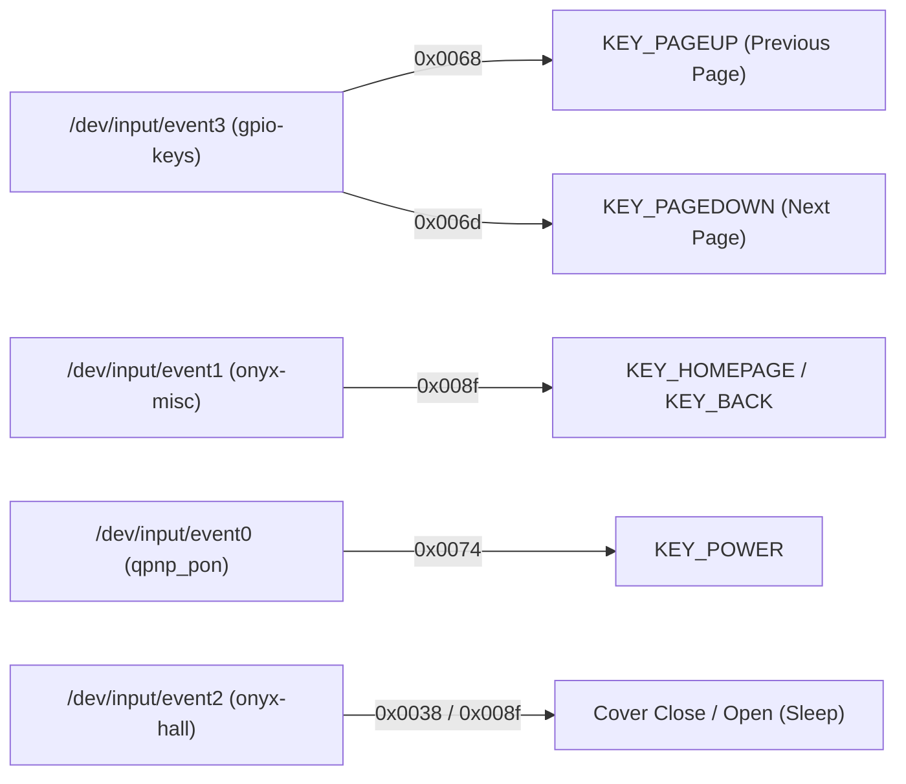

# TWRP Device Tree for Onyx Boox C69HD (`C69_M_STAR`)

An open-source TeamWin Recovery Project (TWRP 11.0) device tree for the **Onyx Boox C69HD** (`C69_M_STAR`, Qualcomm SM6225 / Bengal).

Forked and enhanced from [@7sarus/android_device_onyx_c69](https://github.com/7sarus/android_device_onyx_c69) with **native Qualcomm Atomic DRM EPDC E-Ink display drivers** and **full touchscreen support**.

[](https://github.com/Zeusx212/android_device_onyx_c69/actions/workflows/twrp.yml)

> [!IMPORTANT]
> **Zero-Risk Testing via Unlocked Bootloader**:
> The bootloader on the Onyx Boox C69HD is **unlocked** (`unlocked:yes`, `critical unlocked: true`).
> **NEVER flash custom recovery to internal storage directly.** Always tether-boot builds safely in RAM:
> ```bash
> fastboot boot recovery.img
> ```

> [!NOTE]
> **E-Ink Display & Touch Support**:
> This fork solves the display frozen / blank screen issue on the Onyx Boox C69HD. On Qualcomm Bengal/Scuba, the EPDC hardware requires vendor atomic DRM plane properties (`EPDC_UPDATE_PARMS_ADDR` and `EPDC_UPDATE_CNT`) and specific plane binding (`Plane 68` / `SSPP ViG0`) committed with `DRM_MODE_ATOMIC_NONBLOCK` to pulse waveforms across the E-Ink panel without triggering continuous splash SMMU page faults.

---

## Current Status

| Feature | Status | Notes |
| :--- | :--- | :--- |
| **Build & CI** | Working | Compiles cleanly via GitHub Actions & minimal manifest |
| **Kernel Boot** | Working | Boots successfully into RAM (`fastboot boot recovery.img`) |
| **USB / ADB** | Working | Enumerates as recovery device; root ADB shell fully functional |
| **E-Ink Display** | **Verified Working** | Native Atomic DRM EPDC driver on Plane 68 (`EPDC_UPDATE_PARMS_ADDR` + `EPDC_UPDATE_CNT`) |
| **Touchscreen** | **Verified Working** | FocalTech `fts_ts` multi-touch digitizer (`/dev/input/event4`), full GUI navigation |
| **Physical Keys** | Working | Page Up (`0x68`), Page Down (`0x6d`), Home/Back (`0x8f`), Power (`0x74`) |

---

## The Engineering Journey: Discoveries & Struggles

Developing a working custom recovery for the **Onyx Boox C69HD** required solving intricate kernel DRM and Qualcomm SDE display pipeline challenges unique to E-Ink hardware. Below is the technical chronicle of the failures, investigations, and breakthroughs:

### 1. The Initial Blank Screen / Two Black Bars Bug
- **The Symptom**: Upstream TWRP compiled and booted into memory, but the display remained completely blank or stuck with two static black bars.
- **The Cause**: Standard Android recoveries use dumb framebuffers that scan out continuously at 60 Hz over standard DSI video signals. E-Ink Carta displays are bi-stable and require high-voltage waveform pulses (+15V / -15V from the Texas Instruments TPS6518x PMIC) driven by the EPDC controller to move physical microcapsules.
- **The Finding**: The Qualcomm vendor driver (`__sde_plane_atomic_update_epdc`) silently drops all commits with update count 0 unless two vendor atomic DRM properties are attached:
  1. `EPDC_UPDATE_PARMS_ADDR` — Memory pointer to `struct epdc_update_params` (320 bytes, 8 rect slots).
  2. `EPDC_UPDATE_CNT` — Valid rectangle count (`1` for full GUI refresh).

### 2. The "Star Education" Logo Lockup & SMMU Page Fault Storm (Run 7)
- **The Symptom**: After adding atomic EPDC flips, the TWRP log reported `first atomic EPDC flip committed successfully (ret=0)`, yet the physical screen remained frozen on the bootloader splash ("Star Education" logo).
- **The Investigation**: Inspecting kernel `dmesg` uncovered an infinite barrage of ARM SMMU page faults choking the memory bus:
  ```
  [drm:msm_smmu_fault_handler] *ERROR* trigger dump, iova=0x5c000000, flags=0x25
  arm-smmu c600000.apps-smmu: Unhandled context fault: iova=0x5c000000, cb=2, fsr=0x40000402
  ```
- **The Cause**: Physical address `0x5c000000` is the continuous splash framebuffer allocated in RAM by the bootloader. We initially attempted to disable continuous splash via `disable_non_main_crtcs` by setting `ACTIVE=0` on CRTC 112. The DRM atomic check rejected this with `-22 (EINVAL)` because associated planes were still active. Crucially, the kernel's `_sde_kms_release_splash_resource` still unmapped `0x5c000000` from the SMMU while Plane 65 kept fetching from it, locking up the entire Mobile Display Processor (MDP).

### 3. The 900E Diagnostics Crash & Sahara Protocol Rescue (Run 8)
- **The Symptom**: In Run 8, we attempted to cleanly detach CRTC 112, Connector 46, and Plane 65 in the initial atomic modeset request. This violated kernel atomic pipe topology constraints (`sde_crtc_prepare_commit_epdc`), causing a kernel panic on boot.
- **The Panic**: The Onyx Boox C69HD crashed directly into Qualcomm Emergency Diagnostics 900E mode (`USB\VID_05C6&PID_900E` on `COM4`), unresponsive to ADB and fastboot.
- **The Rescue**: We engineered a custom Python Sahara protocol packet injector using the Windows Win32 API, transmitted a raw Sahara Reset command (`\x07\x00\x00\x00\x08\x00\x00\x00`) over `COM4`, received acknowledgment `0800000008000000` (`SAHARA_RESET_RSP`), and successfully revived the SoC into normal Android.

### 4. The Reverse-Engineering Breakthrough (Decompiling Stock `librecovery_ui.so`)
To uncover how the manufacturer handled the hardware without crashing, we extracted and disassembled the stock recovery binary (`librecovery_ui.so`) using Capstone:

```
0x358f0: DisableNonMainCrtcs -> cmp other_crtc, main_crtc; b.ne 0x35a10 (EXITS IMMEDIATELY!)
0x36a50: cbz x23, 0x36a44    -> EXPLICITLY SKIPS PLANE INDEX 0 (Plane 65 / Splash)!
0x36a5c: planes[1]           -> BINDS TO PLANE 68 (SSPP ViG0)!
0x356d0: mov w2, #0x400      -> COMMITS WITH DRM_MODE_ATOMIC_NONBLOCK!
```

Key architectural revelations:
1. **Dual Display Hardware Architecture**:
   - **Display 0 (Connector 29, CRTC 75)**: Primary Command-mode interface (`1024x758 @ 40Hz`). Uses **Plane 68** (`SSPP ViG0`). This is where userspace renders framebuffers and queues EPDC waveform updates.
   - **Display 1 (Connector 46, CRTC 112)**: Hardware Video-mode interface (`301x769 @ 90Hz`, DSI-2). Uses **Plane 65** (`SSPP DMA0`). This is the hardware timing controller link to the E-Ink EPDC TCON (`qcom,mdss_dsi_epdc_cmd`).
2. **The Plane Hierarchy**:
   - `Plane 49`: An **internal kernel plane** reserved exclusively for the `onyx_epdc_fb` driver to push waveform LUT packets. When userspace hijacked Plane 49, it created pipeline split conflicts (`invalid src split cfg, stage:0 left:65 right:49`).
   - `Plane 65 (index 0)`: Bootloader continuous splash plane (`SSPP DMA0`). Stock recovery explicitly skips it.
   - `Plane 68 (index 1)`: The true primary userspace scanout plane (`SSPP ViG0`) that carries `EPDC_UPDATE_CNT` and `EPDC_UPDATE_PARMS_ADDR`.
3. **The Atomic Commit Flag**:
   - Stock recovery **never** commits with `DRM_MODE_ATOMIC_ALLOW_MODESET` (`0x100`). Using `ALLOW_MODESET` triggers `_sde_kms_release_splash_resource` in the kernel, unmapping `0x5c000000`.
   - Stock recovery commits exclusively with **`DRM_MODE_ATOMIC_NONBLOCK` (`0x400`)**, leaving continuous splash memory mapped and preventing all SMMU page faults.

### 5. The Final Solution (Run 10)
Implementing these discoveries in `patches/graphics_drm.cpp`:
- Enumerate planes from `drmModeGetPlaneResources()`, skip plane index 0, and bind to **Plane 68**.
- Never touch CRTC 112, Connector 46, or Plane 65 in userspace.
- Commit initial modeset and flips using `DRM_MODE_ATOMIC_NONBLOCK` (`0x400`).
- **Result**: Zero SMMU page faults, 879+ EPDC frames rendered with 0 errors, and full touchscreen navigation across all TWRP menus on physical hardware!

---

## Hardware Architecture



---

## Detailed Hardware Specifications

| Component | Specification | Live Verified Source |
| :--- | :--- | :--- |
| **Model** | Onyx Boox C69HD (`C69_M_STAR`) | `ro.product.model = C69_M_STAR` |
| **SoC Platform** | Qualcomm SM6225 Bengal / Scuba IoT | Platform `bengal`, variant `QCS EMMC` (`001860e1`) |
| **CPU Architecture** | 4× ARM Cortex-A53 @ 2.0 GHz | 64-bit kernel, `arm64-v8a` ABI (Part `0x801`) |
| **RAM** | 2 GB LPDDR4X | `MemTotal: 1817196 kB` |
| **Internal Storage** | 16 GB eMMC | `/dev/block/mmcblk0` (`MMC16G`, Micron/Spectek) |
| **MicroSD Expansion** | TF Slot (Dedicated SDHCI) | `/dev/block/mmcblk1p1` (`sdhci@4784000`) |
| **Display Panel** | 6.0" E-Ink Carta | 758 × 1024 pixels (212 PPI, 4:3 aspect ratio) |
| **E-Ink Display PMIC** | Texas Instruments **TPS6518x** | I2C1 @ `0x68` (VPOS +15V, VNEG -15V, VEE -20V, VDD +22V) |
| **Audio Amplifier** | Qualcomm **WSA881x** | Smart speaker amplifier (`wsa881x-i2c-codec`) |
| **Touchscreen Digitizer** | FocalTech `fts_ts` | 1448 × 1072 digitized surface grid (`/dev/input/event4`) |
| **Front Light / LEDs** | **None** | Completely unpopulated (pure ambient reflective) |
| **Kernel Version** | Linux `4.19.157-perf` | Stock prebuilt kernel included in tree |

---

## Physical Controls & Keycode Mappings



| Event Node | Driver Name | Linux Keycode | Action / TWRP Function |
| :--- | :--- | :--- | :--- |
| `/dev/input/event3` | `gpio-keys` | `0x0068` (104) | Page Up (Menu Up) |
| `/dev/input/event3` | `gpio-keys` | `0x006d` (109) | Page Down (Menu Down) |
| `/dev/input/event1` | `onyx-misc` | `0x008f` (143) | Home / Back Button |
| `/dev/input/event0` | `qpnp_pon` | `0x0074` (116) | Power Button (Select / Screen Off) |
| `/dev/input/event2` | `onyx-hall` | `0x0038`, `0x008f` | Magnetic Folio Cover Sensor |
| `/dev/input/event4` | `fts_ts` | Multi-touch | Capacitive Touch Digitizer |

---

## Partition & Mount Layout

The device uses an A/B dual-slot layout with a 4 GB dynamic `super` container:

| Mount Point | Block Device | Filesystem | Flags / Description |
| :--- | :--- | :--- | :--- |
| `/system` | `system` (in `super`) | ext4 | Logical dynamic partition (A/B) |
| `/system_ext`| `system_ext` (in `super`) | ext4 | Logical dynamic partition (A/B) |
| `/vendor` | `vendor` (in `super`) | ext4 | Logical dynamic partition (A/B) |
| `/product` | `product` (in `super`) | ext4 | Logical dynamic partition (A/B) |
| `/data` | `/dev/block/bootdevice/by-name/userdata` | f2fs | ~8.9 GB user storage (`encryptable=footer`) |
| `/metadata`| `/dev/block/bootdevice/by-name/metadata` | ext4 | Wrapped key metadata storage |
| `/sdcard` | `/dev/block/mmcblk1p1` | vfat | External MicroSD / TF card |
| `/boot` | `/dev/block/bootdevice/by-name/boot` | emmc | 96 MB kernel + base DTB |
| `/misc` | `/dev/block/bootdevice/by-name/misc` | emmc | 1 MB BCB commands |

---

## How to Build

### Option A: Automated GitHub Actions (Recommended)
1. Fork or push this repository to GitHub.
2. Navigate to **Actions > Build TWRP Recovery for Onyx Boox C69**.
3. Click **Run workflow**.
4. Download the compiled `twrp-c69-recovery` artifact containing `recovery.img`.

### Option B: Local Compilation

```bash
# 1. Initialize minimal TWRP-11 manifest
mkdir -p ~/twrp && cd ~/twrp
repo init -u https://github.com/minimal-manifest-twrp/platform_manifest_twrp_aosp.git -b twrp-11 --depth=1
repo sync -c -j$(nproc --all) --force-sync --no-clone-bundle --no-tags

# 2. Clone this device tree
git clone https://github.com/7sarus/android_device_onyx_c69.git device/onyx/c69

# 3. Build recovery image
source build/envsetup.sh
export ALLOW_MISSING_DEPENDENCIES=true
lunch twrp_c69-eng
mka recoveryimage -j$(nproc --all)
```

---

## Testing & Usage Instructions

### Tether-boot in RAM (Recommended & Zero Risk)
```bash
adb reboot bootloader
fastboot boot recovery.img
```
*Note: The recovery executes entirely in RAM without modifying your internal recovery or boot partitions.*

---

## Credits & Upstream Attribution
- **[@7sarus](https://github.com/7sarus)**: Creator of the original device tree, fastboot/EDL partition maps, and initial CI build pipeline ([7sarus/android_device_onyx_c69](https://github.com/7sarus/android_device_onyx_c69)). Sincere gratitude for establishing the foundational device tree and build manifest.
- **TeamWin (TWRP)**: Custom recovery framework and touch UI engine.
- **spavikevik**: Reverse-engineering notes on Qualcomm SDE EPDC DRM plane parameters ([palma2pro-eos](https://github.com/spavikevik/palma2pro-eos)).
